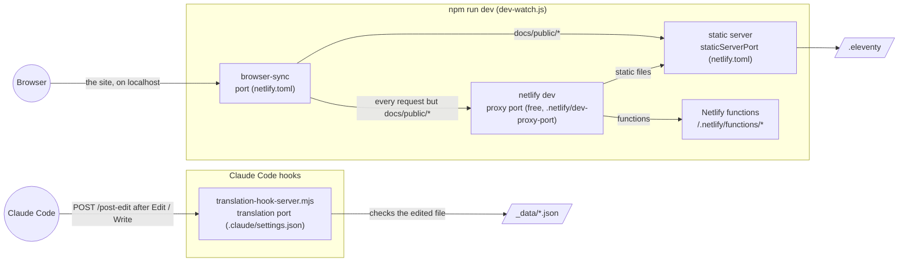

# Portfolio&nbsp;[](https://app.netlify.com/sites/nicoboga/deploys)&nbsp;[](https://sonarcloud.io/summary/new_code?id=nicoboga4075_Portfolio)&nbsp;[](https://gitlab.com/nicoboga4075/Portfolio/-/pipelines?ref=main)

### 🚀  Live Site
This project is deployed on **Netlify** : https://nicoboga.netlify.app

The blog has an Atom feed in each language: [English](https://nicoboga.netlify.app/feed_en.xml) and [French](https://nicoboga.netlify.app/feed_fr.xml).

### 🗂️ Project Structure
The site is built with [Eleventy](https://www.11ty.dev): the pages are HTML files with a front matter, laid out by `_includes/base.njk` and filled from `_data/`. `npm run build` compiles them in place, and the repository root is the folder Netlify publishes.

For an interactive diagram of this architecture, open [GitDiagram](https://gitdiagram.com/nicoboga4075/Portfolio): it generates it from the GitHub repository (replace `hub` with `diagram` in any GitHub URL), and each box links to its file or folder.

```
Portfolio/
├── index_en.html, index_fr.html   Home page, one file per language (as are all the pages below)
├── blog_*.html                    Blog
├── policy_*.html, terms_*.html    Privacy policy and terms of use
├── 404.html                       Not found page
├── articles/                      Blog articles (+ articles.11tydata.js, their shared data)
├── projects/                      Project pages (+ projects.11tydata.js, their shared data)
├── _includes/                     base.njk layout and the partials of the pages and articles
├── _data/                         Texts of the site in every language (nav, hero, about, resume, projects, blog...)
├── js/                            Site scripts (app.js, common.js, botpress.js, analytics.js...), vendored *.min.js, Jest tests
├── css/                           Site styles (common.css, app.css, standalone.css) and vendored styles
├── fonts/, images/                Icon fonts and pictures
├── docs/public/                   CVs, certificates, project videos and the background video of the presentation article, with their subtitles
├── netlify/functions/             Netlify functions in TypeScript (article, env, visit) and their shared HTTP helpers
├── api/                           articles.json and projects.json for the chatbot, written by the build (not committed)
├── service-worker.js              Offline cache (network first for pages, scripts and styles)
├── tests/                         Jest tests of the Netlify functions (tests/jest), Playwright (tests/playwright), Cypress (tests/cypress) and Robot Framework (tests/robot, with ROBOT_FRAMEWORK.md) tests
├── .github/                       GitHub Actions workflows, Dependabot, vendored versions check
├── .claude/                       Claude Code settings, hooks, skills, agents and the portfolio-dev plugin
├── .eleventy.js                   Eleventy configuration (also writes sitemap.xml, feed_*.xml and api/*.json)
├── gen-redirects.js               Writes _redirects from config of package.json
├── uglify-code.js                 Minifies the site scripts after the build
├── hide-folders.js                Hides the generated folders (.eleventy, .netlify, api, logs, node_modules, reports) after each build, each npm install (postinstall) or with npm run hide:folders: hidden attribute on Windows, hidden flag on macOS, .hidden file on Linux
├── adb-reverse.js                 Forwards the dev port of netlify.toml from the Android device (npm run adb:reverse, adb:unreverse)
├── _headers, _redirects           Netlify headers (CSP, cache) and redirects
├── netlify.toml                   Netlify build settings and plugins
├── .gitlab/.gitlab-ci.yml         GitLab CI pipeline (self-hosted Windows runner, see CI/CD below)
└── *.md                           README.md, SECURITY.md, CHANGELOG.md, CONTRIBUTING.md, CLAUDE.md
```

Generated and not committed: `.eleventy/` (output of `npm run dev`), `api/`, `sitemap.xml`, `feed_*.xml`, `reports/` (test reports) and `logs/`.

### 🔌 Local Ports
`npm run dev` ([`dev-watch.js`](dev-watch.js)) and the Claude Code hooks listen on four local ports:

| Port | Value | Set in | Listened on by | Role |
|---|---|---|---|---|
| `port` | 8888 | `[dev]` of [`netlify.toml`](netlify.toml) | browser-sync | The local site, the one address to open: it reloads the page after each build and forwards everything else to netlify dev. The Netlify functions trust `http://localhost` on any port only under netlify dev (`CONTEXT` is `dev`) |
| proxy port | free, picked by the system | `dev-watch.js`, written to `.netlify/dev-proxy-port` while it runs (read by the status line) | netlify dev | Serves `.eleventy` with `_redirects`, `_headers`, the environment variables and the functions (`/.netlify/functions/*`), behind browser-sync |
| `staticServerPort` | 3999 | `[dev]` of `netlify.toml` | the static server of netlify dev | Serves the files of `.eleventy`; `dev-watch.js` reads `docs/public/*` straight from it, since netlify dev answers 403 on Windows for a static file matched by a `_redirects` rule |
| translation port | 4799 | the url of the `/post-edit` http hook in [`.claude/settings.json`](.claude/settings.json) | [`translation-hook-server.mjs`](.claude/hooks/translation-hook-server.mjs) | Checks every `_data/*.json` file Claude edits (valid JSON, every language with the same shape); started by a SessionStart hook, stops after 2 hours without a request. Not part of the site |

The tests that open the built site (the `*.browser.spec.js` Playwright specs, Cypress, Robot Framework) use one more, a free port that [`serve-build.mjs`](.claude/skills/robot-test/serve-build.mjs) prints at start-up. The Android app ([`capacitor.config.js`](capacitor.config.js)) loads the local site on `port` too, forwarded from the device by `npm run adb:reverse`.



### 📦 Vendored Libraries
The third-party libraries in `js/` and `css/` are downloaded manually (not npm dependencies), so [Dependabot](.github/dependabot.yml) can't track them. Their versions are recorded in [`.github/vendor-versions.json`](.github/vendor-versions.json) and checked weekly by the [`vendor-versions`](.github/workflows/vendor-versions.yml) workflow, which opens a GitHub issue when a newer release is available. See also [SECURITY.md](SECURITY.md#utilities).

| Library | Version | Source | Purpose |
|---|---|---|---|
| jQuery | 3.7.1 | [npm](https://www.npmjs.com/package/jquery) | DOM manipulation and events used across the site's JS |
| jQuery Migrate | 3.6.0 | [npm](https://www.npmjs.com/package/jquery-migrate) | Restores legacy jQuery APIs some vendored plugins still call |
| jQuery Easing | 1.4.1 | [npm](https://www.npmjs.com/package/jquery.easing) | Extra easing functions for the smooth-scroll nav links |
| Bootstrap | 4.6.2 | [npm](https://www.npmjs.com/package/bootstrap) | CSS grid/layout and UI components on the index and blog pages |
| Popper.js | 1.16.1 | [npm](https://www.npmjs.com/package/popper.js) | Positions Bootstrap's dropdowns and tooltips |
| Chart.js | 4.5.1 | [npm](https://www.npmjs.com/package/chart.js) | Renders the skills/career doughnut charts |
| Stellar.js | 0.6.2 | [npm](https://www.npmjs.com/package/jquery.stellar) | Parallax scrolling on background images |
| Waypoints | 4.0.1 | [npm](https://www.npmjs.com/package/waypoints) | Triggers scroll-based animations when sections enter the viewport |
| Owl Carousel | 2.3.4 | [npm](https://www.npmjs.com/package/owl.carousel) | Powers the testimonial/project carousels |
| Scrollax | 1.0.0 | [npm](https://www.npmjs.com/package/scrollax) | Waypoints wrapper driving the scroll-in animations |
| Animate.css | 3.7.2 | [npm](https://www.npmjs.com/package/animate.css) | CSS animation classes applied on scroll-in |
| i18next | 26.4.3 | [npm](https://www.npmjs.com/package/i18next) | Client-side translations for the multi-language pages |
| chartjs-plugin-doughnutlabel-v3 | 1.2.0 | [npm](https://www.npmjs.com/package/chartjs-plugin-doughnutlabel-v3) | Draws the centered label inside Chart.js doughnut charts |

jQuery, jQuery Migrate, Bootstrap and Animate.css are intentionally kept below their latest major release - see [SECURITY.md](SECURITY.md#major-versions-held-back-on-purpose) for why each one is pinned.

### ⚙️ CI/CD
The project runs two CI pipelines on every push to `main`: GitHub Actions in the cloud, and GitLab CI on a local runner (installed below). Netlify builds and deploys the site on its own.

#### GitHub Actions

| Workflow | Trigger | What it does |
|---|---|---|
| `node.js.yml` (Node.js CI) | push and pull request on `main` | `build`: `npm ci` and `npm run build` on the LTS releases of Node 20 (`lts/iron`, past its end of life, kept for backward compatibility), 22 (`lts/jod`) and 24 (`lts/krypton`). `jest`, `playwright` (Chromium, Firefox and WebKit), `cypress` and `robot` (Python 3.13, the lock with hashes of [`tests/robot/requirements.txt`](tests/robot/requirements.txt), wheels only, on the preview build served by `serve-build.mjs`): side by side on the Node of [`.nvmrc`](.nvmrc) (22.23.3, also read by Netlify for its build and by the other workflows), each failing the run on a failed test and uploading its reports (`reports-jest`, `reports-playwright`, `reports-cypress`, `reports-robot`) even then. `sonar`: SonarCloud scan of those reports, also after a failed test, skipped for Dependabot. Every job declares `permissions: contents: read` |
| `claude-code-review.yml` (Claude Code Review) | pull request opened, pushed or reopened | Claude reviews the pull requests of the repository owner, including the commits Claude pushes on them, and leaves inline comments, then posts one comment with the issues to close, update or open, when there are some. On a Dependabot pull request (which the `code-review` plugin skips as automated), Claude reads the release notes instead and posts one comment: a verdict, the changes that affect this repository, the issues to close, update or open, the overrides of package.json to add, change or remove (from `npm run check:overrides` and `npm audit`, after an `npm ci --ignore-scripts`), and a reminder to run `npm approve-scripts <name>` when an `allowScripts` entry of package.json still pins the old version (Dependabot never updates it, and npm 12 would then skip the install scripts). Skipped on a pull request that changes this workflow itself |
| `claude.yml` (Claude Code) | an issue or comment that mentions `@claude` | Claude answers, edits the code and pushes a branch with a "Create PR" link. Only people with write access can call it (never a bot, so it can't trigger itself). It can't change `.github/workflows/` (the Claude GitHub App has no `workflows` permission) nor open pull requests itself |
| `vendor-versions.yml` (Vendor library version check) | every Monday at 06:00 UTC, or by hand | Compares the libraries vendored in `js/` and `css/` (`.github/vendor-versions.json`) with npm, and opens or updates the "Vendor library updates available" issue with the latest release of the current major and the latest release |
| CodeQL (default setup) | push and pull request | Security analysis of the JavaScript / TypeScript (including the scripts inside the HTML) and of the workflows |

##### Dependabot

`.github/dependabot.yml` checks:

- the npm dependencies every day at 06:00 Europe/Paris, weekends included (a cron schedule: the `daily` interval only runs on weekdays);
- the actions of the workflows every week, including the ones pinned to a commit SHA;
- the Python packages of the Robot Framework tests ([`tests/robot/requirements.in`](tests/robot/requirements.in) and its lock `requirements.txt`, made by pip-compile) every week.

Packages that release together come in one pull request: the `capacitor` group (`@capacitor/*`), the `jest` group (`jest`, `jest-environment-jsdom`) and the `robotframework` group (`robotframework`, `robotframework-seleniumlibrary`). Playwright is only `@playwright/test`, which brings the `playwright` library it shares its engine with, so it needs no group. A Dependabot pull request gets a Claude review of its release notes (see the table above).

Security updates don't wait for the schedule: Dependabot opens them as soon as an advisory is published.

##### Secrets

| Secret | Where | Used by |
|---|---|---|
| `CLAUDE_CODE_OAUTH_TOKEN` | Actions **and** Dependabot secrets | the Claude Code workflows (a workflow started by Dependabot only receives the Dependabot secrets). Generate it with `claude setup-token` |
| `SONAR_TOKEN` | Actions secrets, and a GitLab CI/CD variable | the SonarCloud scans |

#### SonarCloud

The `sonar` job of GitHub Actions (`sonarqube-scan-action`) analyses every pushed commit of `main`. The `sonar-job` of GitLab CI first asks the GitHub API whether a Node.js CI run exists for its commit (same SHA on both remotes): if so it skips its analysis, so a late GitLab analysis never overwrites the state of `main` in SonarCloud nor creates a VERSION event that resets the new code, and waits (up to 20 minutes) for the GitHub `sonar` job to finish to take its verdict: it fails when that job failed (the quality gate included), was cancelled or timed out; only when GitHub has no run for the commit (or its API can't be reached) does GitLab analyse with `npx @sonar/scan`. Both send the same project version: `@sonar/scan` reads it from `package.json`, and the GitHub job passes `-Dsonar.projectVersion` read from `package.json` too, so SonarCloud keeps its "previous version" new code period across both.

#### GitLab CI

`.gitlab/.gitlab-ci.yml` runs on the `windows-local` runner in PowerShell, so only while the computer that hosts it is on: `setup` (runner status), `build` (`npm ci`, `npm run build`), `test` (one job per framework, one after the other since the runner runs one job at a time: Jest, Playwright, Cypress and Robot Framework, each of the last two only while its tests exist, Robot Framework on the built site served by `serve-build.mjs`), `sonar` (`npx @sonar/scan` only when GitHub Actions doesn't analyse the commit, allowed to fail) and `teardown` (cleans the build folder).

The file is not at the root, where GitLab looks by default: the project setting **Settings → CI/CD → General pipelines → CI/CD configuration file** is set to `.gitlab/.gitlab-ci.yml`.

##### Install the GitLab Runner

- The `gitlab-runner` will execute the pipeline on the local computer.  
- Download the `gitlab-runner.exe` `64bit version` file from [official website](https://docs.gitlab.com/runner/install/windows.html).  
- Place this file in `C:\GitLab-Runner\gitlab-runner.exe` *(you must rename the file)*.  
Open an administrator prompt *(otherwise the installation will work but you will have problems during the CI/CD)* and run the following commands :
- `cd C:\GitLab-Runner`
- `.\gitlab-runner.exe install` : Installation of the service gitlab-runner
- `.\gitlab-runner.exe start` : Start the service
- `.\gitlab-runner.exe register`: Registration of the runner
    - Enter the gitlab URL `https://gitlab.com/`
    - Enter the registration token. You can get it on `Project ==> Settings ==> CI/CD ==> Runners ==> Project runners`
    - Enter the name of the runner
    - Enter the runner executor : `shell`
- Then edit the file `C:\GitLab-Runner\config.toml` and make sure the file looks like below.  
```toml
concurrent = 1
check_interval = 0
shutdown_timeout = 0

[session_server]
  session_timeout = 1800

[[runners]]
  name = "<name>"
  url = "https://gitlab.com/"
  id = "<id>"
  token = "<token>"
  token_obtained_at = 2025-07-06T19:17:21Z
  token_expires_at = 0001-01-01T00:00:00Z
  executor = "shell"
  shell = "pwsh"
```
- Change pwsh for shell execution (to powershell for Windows runner or bash for Linux runner).
- Check the runner exists and is valid with 
    - `.\gitlab-runner.exe list`
    - `.\gitlab-runner.exe verify`
    - `.\gitlab-runner.exe status`
- The service can be stopped with `.\gitlab-runner.exe stop`.
- `.\gitlab-runner.exe` can be replaced by `gitlab-runner` in commands, adding `C:\GitLab-Runner` to PATH in system environment variables.

### 📄 License
This project is licensed under [MIT License](LICENSE).
